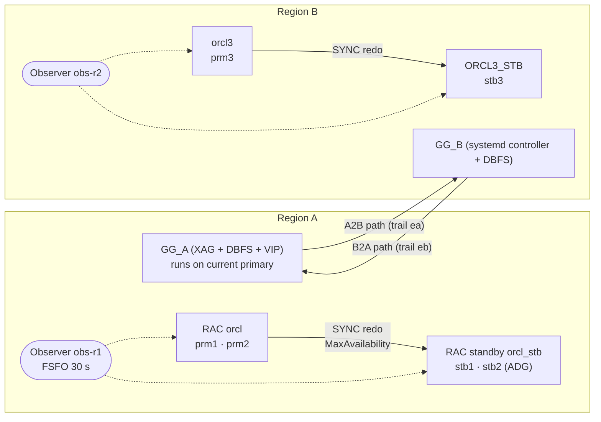

# Oracle HA/DR Failover Lab — RAC + Data Guard FSFO + GoldenGate Active-Active

Self-built two-region Oracle high-availability / disaster-recovery lab on Linux KVM:
two regions, each protected by Data Guard Fast-Start Failover, with GoldenGate 23ai Microservices
replicating **Active-Active** between the regions. The point of the project is not the install
but the **proof**: failover tested under live bidirectional write load, every committed
transaction reconciled on both sites.

> Home lab, not production. Built and operated end-to-end by one person on a 23 GB host.

## Results

Continuous workload: 1 transaction/second written at **each** region; every write opens a new
connection (like an application with retry). After each test, every transaction the client saw
as committed is checked on **both** databases ([`tests/verify.py`](tests/verify.py)).

| # | Scenario | Data loss | App write outage (Region A) | Active-Active fully back | Result |
|---|----------|-----------|-----------------------------|--------------------------|--------|
| 0 | Baseline, both regions writing | 0 | – | – | PASS |
| 1 | Broker switchover prm1 → stb1 | 0 | ~25 s | ~1 min 45 s | PASS |
| 2 | Switchback stb1 → prm1 | 0 | ~20 s | ~1 min 30 s | PASS |
| 3 | **Power-off primary** (`virsh destroy prm1`), FSFO | 0 | ~64 s | GG did **not** restart → [finding F1](docs/findings.md#f1) | PASS (data) |
| 4 | Power-off primary stb1 → prm1, after fix | 0 | ~67 s | 2 min 12 s, fully automatic | PASS |
| 5 | **Power-off primary prm1 → stb1, after fix** | 0 | ~65 s | **1 min 54 s, fully automatic** | PASS |

- **RPO = 0** across 4,242 committed transactions (cumulative), including transactions committed
  seconds before the power-off — FSFO Zero Data Loss Mode + Extract `HANDLEDLFAILOVER`.
- Region B (the other side of Active-Active) kept writing through every test with **zero errors**;
  its changes were queued in trail and applied once GoldenGate came back on the new primary.
- Raw evidence: [`results/`](results/) (client logs, row dumps of both DBs, 5-second timelines).
  Details per test: [`docs/failover-test-report.md`](docs/failover-test-report.md).

## Re-run after the security hardening (2026-10-29)

Same harness, same 4 VMs (prm1, stb1, obs-r1 + prm3), after the
[security lab](https://github.com/phuochuyy/oracle-security-compliance-lab) changed Region A: TDE (ORCLPDB2's
`APP_DATA`, where `APP.TXN` lives), native network encryption required, GoldenGate trail encryption, observer
and broker as a SYSDG-only user. Evidence: `results/raw/r2_*`, `results/timelines/r2_*`.

| # | Scenario | Data loss | App write outage (Region A) | Active-Active fully back | 2026-10-27 | Result |
|---|----------|-----------|-----------------------------|--------------------------|------------|--------|
| 0 | Baseline | 0 / 64 | – | – | – | PASS |
| 1 | Switchover prm1 → stb1 | 0 | 24 s | 1 min 22 s | ~25 s / ~1 min 45 s | PASS |
| 2 | Switchback stb1 → prm1 | 0 | 27 s | 1 min 53 s | ~20 s / ~1 min 30 s | PASS |
| 5 | **Power-off prm1**, FSFO → stb1 | 0 | 72 s (stb1 primary +43 s) | **2 min 20 s**, automatic | ~65 s / 1 min 54 s | PASS |
| 4 | **Power-off stb1**, FSFO → prm1 | 0 | 66 s (prm1 primary +44 s) | **2 min 11 s**, automatic | ~67 s / 2 min 12 s | PASS |

- **1,862 committed transactions, 0 lost**; in both power-off tests the transaction committed in the very
  second of the power-off (#260, #681) is on both databases. Region B: 0 errors throughout.
- FSFO auto-reinstated the old primary each time (141 s / 136 s after the VM was started again).
- Database failover is unchanged (43–44 s); GoldenGate's restart after a failover took longer
  (Extract/Replicat first `ABENDED`, restarted by the HA profile) — 2 min 11–20 s instead of 1 min 54 s.
- The harness had a gap on a fresh lab: `check.sh` failed when no client log existed yet — fixed.

## Run 3 — after the password rotation (2026-10-29 evening)

Why: the shared lab password had been rotated (XAG, GoldenGate users and path credentials, DBFS wallets,
`pathsync.conf`) — only a failover proves that the automatic recovery still works. Evidence:
`results/raw/r3_*`, `results/timelines/r3_*`.

| # | Scenario | Data loss | New primary open read-write | App writes again | Active-Active fully back | Result |
|---|----------|-----------|-------------|------------------|--------------------------|--------|
| 0 | Baseline | 0 | – | – | – | PASS |
| 5 | **Power-off prm1**, FSFO → stb1 | 0 | +52 s | +72 s | **did not come back**: XAG on stb1 failed after its 300 s start timeout → fixed by hand, back at 14 min | PASS (data) |
| 4 | **Power-off stb1**, FSFO → prm1 | 0 | +49 s | +76 s | **1 min 39 s**, automatic | PASS |
| 5b | **Power-off prm1** again, after the fix | 0 | +52 s | +74 s | **1 min 49 s**, automatic | PASS |
| 2 | Switchover back to prm1 | 0 | – | – | 2 min 1 s | PASS |

- **2,535 committed transactions, 0 lost** across the four events; FSFO reinstated the old primary each
  time (80 s, 200 s, 180 s after the VM was started).
- **The finding — my own rotation missed a dependency:** XAG keeps the GoldenGate admin password **per
  cluster**. I had updated it on the primary's cluster (prm1/prm2) but not on the standby's (stb1/stb2):
  XAG's health check on stb1 returned `3` for 5 minutes (it returned `0` in the morning run), the start timed
  out and CRS stopped DBFS again. `agctl modify goldengate GG_A --adminuser oggadmin` on stb1 → `0`
  at once; the next failover to stb1 (5b) recovered by itself in 1 min 49 s.
- The harness reused the previous run's client logs: `verify.py` compared the morning's 1,862 transactions
  with an empty table (FAIL). The old logs are moved aside before a new run now (`/tmp/wl_prev_*`).
- Before this run GoldenGate Extract on prm1 had been down for 40 min: see the backup lab's README
  (archived logs it still needed were deleted; restored from backup).

## Snapshot standby drill (Region B) — [`tests/snapshot_standby.sh`](tests/snapshot_standby.sh)

| Step | Result |
|------|--------|
| FSFO off, `CONVERT DATABASE 'ORCL3_STB' TO SNAPSHOT STANDBY` | **4 s**, `SNAPSHOT STANDBY / READ WRITE`, guaranteed restore point created |
| test on the snapshot standby: 1,000 rows inserted, 100 accounts updated; meanwhile 1 row committed on the primary | standby sees its 1,000 rows, **not** the primary's row: redo arrives (transport lag 0), it is not applied (apply lag 18 s) |
| `CONVERT ... TO PHYSICAL STANDBY` (broker restarts the instance) | **21 s**, restore point gone; 1,000 test rows gone, the primary's row applied, apply lag 0, BANKDB checksums **PASS** (the update was discarded), FSFO back, `SUCCESS` |

Logs: [`results/snapshot-standby.log`](results/snapshot-standby.log). First attempt
([log](results/snapshot-standby-first-attempt.log)): the broker said `SUCCESS` while the just-started
standby still had **5 h 53 min apply lag** (transport lag 0), so the converted standby did not have the
test table yet — the script now waits for apply lag 0. After the conversion back the broker leaves the
standby `MOUNTED`; the script reopens it read-only (PDB `PERF` excluded: `STANDBYS=NONE`).

## Architecture



| Component | Implementation |
|-----------|----------------|
| Database | Oracle 23ai (23.26) on Oracle Linux 9.8, CDB/PDB; GI 23ai, ASM |
| Region A HA | 2-node RAC → 2-node RAC standby, Broker, MaxAvailability, FSFO Zero Data Loss, auto-reinstate |
| Region B HA | Single instance → physical standby, Broker, FSFO (observer obs-r2) |
| Replication | GoldenGate 23.26.1 MA, Integrated Extract + Parallel Replicat, Auto-CDR, loop prevention via tag `00` |
| GG HA on RAC | XAG `--dataguard_autostart`, deployment on **DBFS** (Data Guard carries it to the standby), app VIP, nginx reverse proxy |
| GG HA without GI | [`ogg-ha-controller.sh`](lab/files/ogg-ha-controller.sh): systemd loop that runs GG only when the local DB is PRIMARY |
| Path retarget | [`ogg-path-sync.py`](lab/files/ogg-path-sync.py): after a role change, re-points both distribution paths to the live peer |
| Failover gap fix | [`ogg-fan-callout.sh`](lab/files/ogg-fan-callout.sh): FAN callout that starts GG after FSFO failover |

More: [`docs/architecture.md`](docs/architecture.md).

## Problems found and fixed

Testing under failure found issues a happy-path install never shows. Full write-ups in
[`docs/findings.md`](docs/findings.md).

1. **XAG does not start GoldenGate after FSFO failover** (only after switchover): on failover CRS
   starts the role-based service without pullups (`Opts 2102`, `ORA_STATE_HINT=NO_PULLUPS`).
   Fixed with a FAN server-side callout; verified with two further power-off tests.
2. GoldenGate `HA` restart profile waited 60 s before restarting abended processes → tuned to 15 s,
   cutting ~40 s from recovery.
3. Lab automation enabled FSFO while the primary was still `TRANSPORT-OFF` (command sent before the
   DB opened) → now retries until the broker confirms the state.
4. Over-reserved HugePages (2 GB for a 1.36 GB SGA) on 5 GB standby VMs → resized, freeing ~690 MB.

## Repository layout

```
lab/        labctl.sh (scenario control) + HA scripts deployed to the VMs
tests/      workload, verification, timeline recorder, helpers   → tests/README.md
results/    raw evidence of the test run
docs/       architecture, test report, findings
```

Credentials are never stored in the repo: copy `lab.env.example` to `lab.env` (git-ignored).

## Limitations

- Host RAM (23 GB) allows one node per RAC cluster at a time, so the failure tests powered off the
  only running node of the primary cluster (a full-site loss). Intra-cluster RAC node failover is
  not covered here.
- Standby VMs at 5 GB swap heavily (~4 GB) when they take over as primary with GoldenGate.
- Open: after the re-run's T4 (failover back to prm1, 12:43), CRS shows the XAG resource
  `xag.GG_A.goldengate` as `STATE=ONLINE` but `INTERNAL_STATE=STOPPING`, still hours later
  (`RESTART_COUNT=0`, `FAILURE_COUNT=0`, XAG checks keep running). Not yet known whether CRS would still
  relocate GG_A on the next failure — to be checked before the next failover test.
